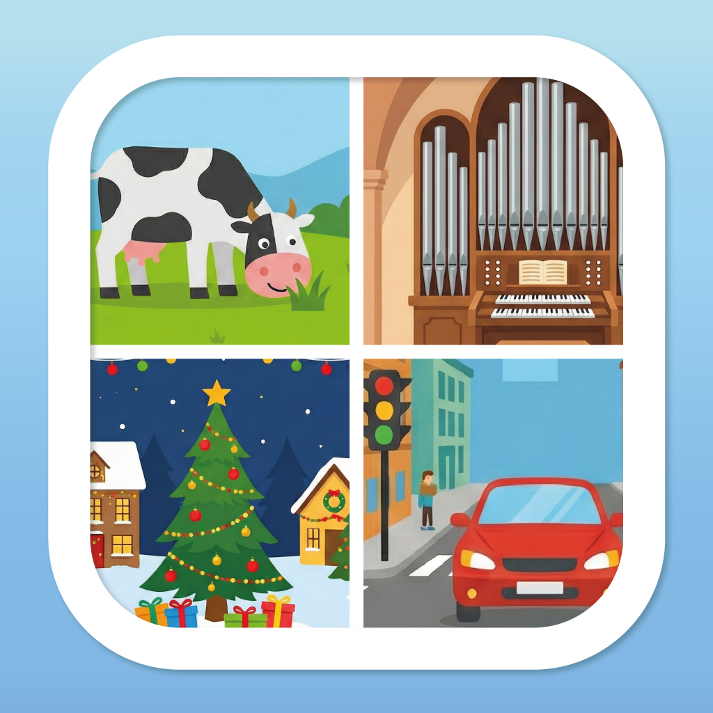

<p align="center">
  
</p>

<h1 align="center">Guck mal! – Reise Bingo</h1>

<p align="center">
  Bingo für Kinder und Familien unterwegs: Wer sieht zuerst die Kuh,<br>
  die Brücke oder das Windrad?
</p>

<p align="center">
  <b>Deutsch</b> · <a href="README.en.md">English</a>
</p>

<p align="center">
  
  
  
</p>

## Worum es geht

Lange Autofahrten, Zugreisen, Wartezeiten: Guck mal! macht aus dem Blick aus
dem Fenster ein Spiel. Auf einem Raster stehen Dinge, die es unterwegs zu
entdecken gibt. Wer eines sieht, tippt es an; eine volle Reihe ist ein Bingo.

Die App ist für Kinder gemacht. Sie kommt ohne Konto, ohne Werbung, ohne
Tracking und ohne Internetverbindung aus.

## Funktionen

- **Drei Spielmodi:** Suche ohne Zeitdruck, Jagd auf ein Ziel von ein bis fünf
  Bingos, Sprint auf Zeit, jede und jeder auf dem eigenen Gerät
- **Sieben Orte:** Autobahn, Land, Stadt, Zug, Kirche, Zuhause, Zoo
- **Rund 250 Dinge zum Entdecken**, mit Bild und je nach Jahreszeit
  ausgewählt: Frühling und Sommer, Herbst und Winter
- **Feste im Jahr:** eigene Dinge, Farben und Effekte zu Ostern, im Herbst,
  zu Halloween und zu Weihnachten
- **Sechs Sprachen:** Deutsch, Englisch, Spanisch, Französisch, Italienisch,
  Niederländisch
- **Barrierearm:** Beschriftungen für Screenreader

## Installation

[**App Store**](https://apps.apple.com/de/app/id6755447380) ·
[**Google Play**](https://play.google.com/store/apps/details?id=de.revisor.guckmalreisebingo)

Die App kostet einmalig 0,99 €. Es gibt keine Käufe in der App und kein Abo.

## Warum der Quelltext offen ist

Eltern sollen nachsehen können, was eine App auf dem Gerät ihrer Kinder tut.
Hier steht der ganze Quelltext der App, so wie sie im Store liegt. Wer selbst
programmiert oder jemanden fragt, der es tut, kann nachprüfen, was unten unter
Datenschutz steht.

## Datenschutz

- **Keine Daten verlassen das Gerät.** Die App sendet nichts an einen Server,
  auch nicht an den Entwickler. Es gibt keine Analyse, keine Absturzberichte
  und keine Werbenetzwerke.
- **Keine Berechtigungen:** kein Standort, keine Kamera, kein Mikrofon, keine
  Kontakte.
- **Gespeichert wird nur auf dem Gerät:** der laufende Spielstand und die
  Einstellungen.
- Links in den Einstellungen (Datenschutzerklärung, Impressum, Bewerten)
  öffnen sich erst nach einem Tipp im Browser oder Store.

Die vollständige Datenschutzerklärung steht auf
[simonluthe.de](https://simonluthe.de/apps/guckmal/datenschutz/).

## Versionen

Was sich wann geändert hat, steht in [CHANGELOG.md](CHANGELOG.md). Die
[Releases](https://github.com/Revisor01/GuckMalBingoFlutter/releases) fassen
jede Version zusammen.

## Aufbau

Flutter-App für iOS und Android, eine Codebasis.

```
lib/
├── main.dart     Ablauf: Modus → [Ziel] → Kategorie → [Saison] → Ort → Größe → Spiel
├── models/       Spielkonfiguration, Dinge, Orte, Jahreszeiten, Modi, Themes
├── viewmodels/   Spiellogik
├── views/        Bildschirme
├── data/         alle Dinge zum Entdecken, mit Übersetzungen
├── utilities/    Klang, Farben, Texte, Sprachen
└── l10n/         Übersetzungen der Oberfläche
```

Zum Nachvollziehen auf dem eigenen Rechner (die Lizenz erlaubt das zum Lernen
und Prüfen):

```bash
flutter pub get
flutter test
flutter run
```

## Mitmachen

Fehlermeldungen und Vorschläge sind willkommen, bitte als
[Issue](../../issues/new/choose). Sicherheitslücken bitte vertraulich melden,
wie in [SECURITY.md](SECURITY.md) beschrieben. Pull Requests sind willkommen;
was dabei für die Rechte an deinem Beitrag gilt, steht in
[CONTRIBUTING.md](CONTRIBUTING.md).

## Lizenz

**Quelloffen zur Einsicht — Nutzung nur mit schriftlicher Erlaubnis.**
Der vollständige Text steht in [LICENSE](LICENSE), eine englische Übersetzung
in [LICENSE.en.md](LICENSE.en.md) (maßgeblich ist die deutsche Fassung).

- **Ohne Weiteres erlaubt:** lesen, herunterladen, studieren, zum Lernen und
  Prüfen auf eigenen Geräten ausführen, Fehler melden, darüber berichten.
- **Braucht eine Vereinbarung:** eine selbst gebaute Fassung im Alltag nutzen,
  auch in der eigenen Familie, eigene Fassungen weitergeben, auch in App
  Stores, und Teile des Codes in anderer Software verwenden. Gespielt wird mit
  der App aus dem Store.
- Bilder, Klänge und der Name „Guck mal!“ sind nicht mitlizenziert.

## Kontakt

Pastor Simon Luthe · [mail@simonluthe.de](mailto:mail@simonluthe.de) ·
[simonluthe.de](https://simonluthe.de)
